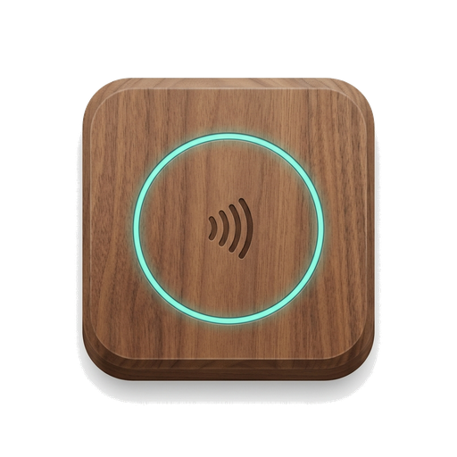

  

<h1 align="center">TagBlock</h1>

  <strong>Room-aware NFC tag &amp; multi-reader manager for Home Assistant</strong> 
  Turn physical NFC cards, stickers, or wooden tokens into tactile smart-home controls — with zero manual automations or helper clutter.

---

## What Is TagBlock?

**TagBlock** pairs a lightweight **Home Assistant custom integration + sidebar UI** with **modular ESPHome firmware** for ESP32 + PN532 NFC readers.

Instead of wiring up brittle YAML automations for every tag or limiting yourself to a single music player, TagBlock gives you:

- **One card, any room:** Place multiple NFC readers around your home and give each reader its own **Room Defaults** (default speaker & to-do list). Map a tag to **`📍 Reader's Room (Auto)`**, and the exact same physical card will play on whichever room's speaker you tap it in.
- **More than just music:** Play Music Assistant playlists/tracks (with built-in library search, volume, shuffle, radio mode, and queue options), start countdown timers with phone alerts, send push notifications, add items to shopping/to-do lists, arm/disarm Alarmo, or run any Home Assistant Script or Scene.
- **Multi-action combos:** Chain multiple actions on a single tag (e.g., activate a lighting scene *and* start a playlist in one tap).
- **Tap & Hold-to-Play:** Support both momentary taps (with optional **re-tap to play/pause** and scan debounce) and **tag-removed detection** (lift a token off the reader to pause that room's music or cancel a timer).
- **Zero helper clutter:** Unlimited tags and room profiles are stored cleanly in Home Assistant's native `.storage/tagblock.storage`. Works with any NFC tag UID (NTAG213/215/216 stickers, cards, keyfobs, or read-only tags).

---

## Sidebar UI Overview

TagBlock adds a dedicated **TagBlock** panel to your Home Assistant sidebar with two tabs:

1. **Mapped Tags:**
   - **Left:** Searchable list of all your tags, live active timer countdowns, quick **▶ Test** buttons, and a **`+ Add Tag`** button.
   - **Right:** Context-aware **Action Editor** — click any tag in the list to edit it, or simply tap an unmapped physical NFC tag on any reader to open the editor with the Tag ID pre-filled.
   - Includes a live **Music Assistant Search** picker so you can search playlists, albums, tracks, and radio stations without leaving Home Assistant.
2. **Tag Readers:**
   - Automatically discovers every ESPHome TagBlock / Adonno NFC reader in Home Assistant and renders a control card for each.
   - Configure each reader's **Room Defaults** (Default Speaker & Default To-Do List), toggle its LED/buzzer feedback, write/clean NFC tags, and inspect diagnostics.

---

## Installation (Home Assistant)

### Option 1 — HACS / Home Assistant Marketplace (Recommended)
1. Open **HACS** (or **Settings → Marketplace**) in Home Assistant.
2. Click **`⋮`** → **Custom repositories**.
3. Add `https://github.com/wartos100/TagBlock` with category **Integration**.
4. Search for **TagBlock** and click **Download**.
5. **Restart Home Assistant** (`Settings → System → Restart`).
6. Go to **Settings → Devices & Services → Add Integration**, search for **TagBlock**, and click **Submit**.

### Option 2 — Manual Installation
1. Copy `custom_components/tagblock` into `/config/custom_components/tagblock`.
2. Restart Home Assistant.
3. Go to **Settings → Devices & Services → Add Integration** and add **TagBlock**.

---

## ESPHome Firmware (Modular Multi-Reader Setup)

TagBlock ships with modular ESPHome packages under [`esphome/packages/`](esphome/packages/) so you can manage multiple readers with minimal duplication:

| Package | Purpose |
| :--- | :--- |
| [`tagblock_base.yaml`](esphome/packages/tagblock_base.yaml) | Core ESP32 + PN532 (I2C) reader, `tag_scanned` & `esphome.tagblock_tag_removed` events, RTTTL buzzer chimes, tag writer buttons & diagnostics. |
| [`led_binary.yaml`](esphome/packages/led_binary.yaml) | Single-color on/off Status LED. |
| [`led_ws2812.yaml`](esphome/packages/led_ws2812.yaml) | Addressable WS2812B RGB LED ring or strip. |
| [`controls_rotary.yaml`](esphome/packages/controls_rotary.yaml) | Optional physical rotary encoder & push button (volume up/down, play/pause, next track) — automatically controls that reader's Default Speaker in TagBlock. |
| [`improv.yaml`](esphome/packages/improv.yaml) | Optional Improv Serial & BLE Wi-Fi provisioning (for browser flashing via ESP Web Tools). |

Start from [`esphome/tagblock-example.yaml`](esphome/tagblock-example.yaml): copy it per room, set `name`, `friendly_name`, and your GPIO pins, and flash via **ESPHome Device Builder**.

> **PN532 Hardware Tip:** Set the tiny onboard DIP switches on your PN532 module to **I2C mode** (`Switch 1 = ON`, `Switch 2 = OFF`).

### Typical Hardware BOM (per Reader)
- **ESP32** dev board (ESP32-WROOM / ESP32-S3 / ESP32-C3)
- **PN532** 13.56 MHz NFC module (I2C mode)
- **5V Passive Piezo Buzzer** (for RTTTL chimes)
- **Status LED** (single-color LED or WS2812B LED ring)
- **Optional:** KY-040 rotary encoder with push button (for physical volume & playback control)
- **NFC Tags:** NTAG215 stickers, cards, or coins (25 mm works reliably through ~3 mm of wood or 3D-printed enclosures)

---

## Compatibility & Testing

TagBlock includes automated GitHub Actions ([`.github/workflows/validate.yml`](.github/workflows/validate.yml)) running on every push and on a monthly schedule:
- **Home Assistant Hassfest** validation
- **HACS** validation
- **Unit tests (`pytest`)** against Home Assistant Core (`pytest-homeassistant-custom-component`)
- **Python, JSON & Frontend JS** syntax checks

## License

[MIT](LICENSE)
